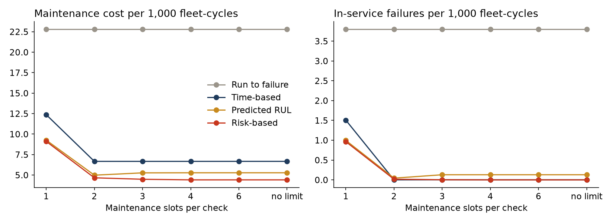
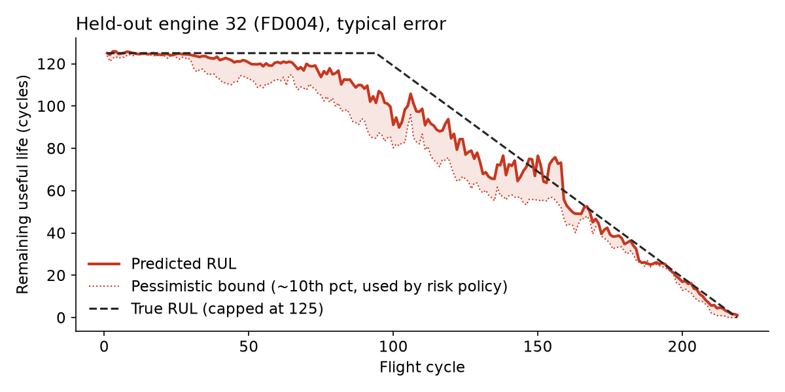

# Fleet Readiness

**Data:** [NASA C-MAPSS turbofan engine degradation dataset](https://data.nasa.gov/dataset/cmapss-jet-engine-simulated-data), run-to-failure sensor histories for 709 simulated jet engines (plus 707 test engines cut off before failure) across four operating scenarios.

**Built with:** Python · pandas · LightGBM · scikit-learn · lifelines · pytest

A predictive-maintenance system that turns sensor data into maintenance decisions. It predicts each engine's remaining useful life (RUL) with a calibrated uncertainty band, then decides which engines to pull for maintenance when there are only a few maintenance slots per check. A simulated fleet scores the result against time-based replacement, the schedule most maintenance programmes run today.

**Result:** on a simulated 30-engine fleet over 3,000 flight cycles, with 2 maintenance slots per check, the risk-based policy cost **30% less** than time-based replacement (4.67 vs 6.67 cost units per 1,000 fleet-cycles), needed **32% fewer** planned removals, threw away **73% less** remaining engine life, and raised availability from **96.7% to 97.7%**. Against running engines to failure, in-service failures fell from 3.80 to 0.02 per 1,000 fleet-cycles.

## Why this matters

Most fleets maintain on a calendar: replace a part after a fixed number of hours or cycles, whatever its condition. That is safe on average but wasteful, because it pulls healthy parts early, and it still misses the unit that degrades faster than average. Condition-based maintenance replaces the calendar with the part's actual health.

A good RUL model alone does not get you there. Maintainers have limited hangar slots, so the real question is "which engines go in this week?" This project answers that question and measures what the answer is worth.

## How it works

1. **Regime normalisation.** Engines fly in six operating conditions (altitude, Mach, throttle) that shift sensor readings far more than wear does. Clustering the operating settings and z-scoring each sensor within its regime leaves the degradation signal.
2. **Leak-free features.** For every cycle: trailing means over 5, 10 and 20 cycles, an exponentially weighted mean, a 20-cycle least-squares slope, and drift from the engine's own first 20 cycles (which removes manufacturing variation). Every feature uses only past cycles of the same engine, and a test proves it.
3. **RUL model.** LightGBM regression on RUL capped at 125 cycles (early in life an engine is "healthy", not "very far from failure"). Quantile models give 10th and 90th percentiles, widened by split-conformal calibration on separate engines so the band covers what it claims.
4. **Maintenance policies.** At every check (every 10 cycles), each policy decides which engines to pull, and in what order when there are more requests than slots:
   - *Run to failure*: never pull.
   - *Time-based*: pull at a fixed age, oldest first.
   - *Predicted RUL*: pull when the point estimate falls below a threshold, lowest first.
   - *Risk-based*: pull when the pessimistic end of the band (~10th percentile) falls below a threshold, most at-risk first.
5. **Fleet simulation.** 30 engine positions, mixed starting ages, 3,000 cycles. A planned removal takes 5 cycles and costs 1 unit. An in-service failure takes 25 cycles and costs 6 units. Each policy's threshold is tuned on one set of held-out engines and scored on another, across 10 random fleets.

## Results

### Remaining-life prediction (NASA's official test sets)

| Subset | Conditions / faults | Fleet-average life | Ridge | **LightGBM** | LightGBM, held-out random cut |
| --- | --- | --- | --- | --- | --- |
| FD001 | 1 / 1 | 36.3 | 16.2 | **11.1** | 9.2 |
| FD002 | 6 / 1 | 35.1 | 15.1 | **10.7** | 13.9 |
| FD003 | 1 / 2 | 49.5 | 15.7 | **9.7** | 9.0 |
| FD004 | 6 / 2 | 54.4 | 16.4 | **10.6** | 14.1 |

RMSE in cycles, with true RUL capped at 125 as is standard for this benchmark. NASA asymmetric scores (late predictions penalised harder) are in `reports/benchmark.json`; LightGBM's FD004 score is 537 against 1,430 for ridge. The last column is a second opinion: 20% of training engines held out and each cut at a random point between 30% and 100% of its life. That is harder than the official set, where many engines are cut early and their capped truth is simply 125 (67 of 248 in FD004), so I'd quote 14 cycles as the honest FD004 figure.

### Maintenance decisions (FD004, held-out engines)



| 2 slots per check | Cost / 1k fleet-cycles | Failures / 1k | Planned removals | Life thrown away | Availability |
| --- | --- | --- | --- | --- | --- |
| Run to failure | 22.82 | 3.80 | 0 | 0 | 90.5% |
| Time-based (age 110) | 6.67 | 0.00 | 600 | 90.6 cycles | 96.7% |
| Predicted RUL (≤ 40) | 4.99 | 0.04 | 425 | 33.1 cycles | 97.5% |
| **Risk-based (10th pct ≤ 28)** | **4.67** | **0.02** | **411** | **24.8 cycles** | **97.7%** |

Means over 10 simulated fleets. Seed-to-seed standard deviation of cost is 0.11 for risk-based and 0.02 for time-based, so the gap is far outside run-to-run noise.

- **Risk-based is the cheapest policy at every capacity tested** (1, 2, 3, 4, 6 and unlimited slots) and at every cost ratio tested: with failures costing 3×, 6× or 12× a planned removal it beats time-based by 33%, 30% and 29%.
- **When capacity is tight, ranking matters.** With one slot per check every policy is saturated, and failures rise for all of them. The risk-based ranking still has the fewest (0.96 per 1k vs 1.51 for time-based), because it sends the engines most likely to fail through first.
- **The time-based baseline is a fair one.** Fitting a Weibull to training-engine lifetimes (shape 3.4, MTBF 252 cycles) and solving the classic age-replacement problem gives an optimal age of 135 cycles. Tuning by simulation found 140. Both methods agree, so the baseline is the best a calendar schedule can do here, not a straw man.
- **The uncertainty band is honest about where it is weakest.** It covers 89% of held-out cycles against an 80% target, but 79% within the last 50 cycles of life, where decisions are made. See [DECISIONS.md](DECISIONS.md).



## Assumptions and limitations

- **Simulated engines.** C-MAPSS is a high-fidelity simulation, not fleet data. Real maintenance records are messier: missing sensors, inconsistent logs, parts lead times.
- **Cost and downtime figures are assumptions**, set in `config.yaml`. The ranking of policies holds across the cost ratios tested; the size of the gap depends on them.
- **One component.** Each position holds one engine and a replacement is always available. Real fleets juggle many components and spare-part stock.
- **Small held-out pool.** The final simulation draws from 37 held-out engines (with replacement). Results are averaged over 10 random fleets to reduce noise.

## Run it

```bash
python -m venv .venv && .venv/bin/pip install -r requirements.txt
.venv/bin/python -m src.fetch_data      # downloads C-MAPSS from NASA (falls back to a GitHub mirror)
.venv/bin/python -m src.run             # benchmark + fleet study, ~3 minutes
.venv/bin/python -m pytest              # leakage, split and simulator tests
```

Outputs land in `reports/`: `benchmark.json`, `fleet_study.json` and the figures above.

## Project layout

```
src/data.py        loading and engine-level splits
src/features.py    regime normalisation and leak-free features
src/models.py      LightGBM point + conformal quantile band, baselines, NASA score
src/policies.py    the four maintenance policies
src/simulate.py    capacity-constrained fleet simulation
src/run.py         end-to-end pipeline and figures
tests/             no look-ahead, no cross-engine leakage, disjoint splits, simulator accounting
config.yaml        every assumption in one place
DECISIONS.md       what was decided and why
```

## What I'd do next

- **Parts and lead times.** Add spare-part inventory so a removal can wait on parts, which is where much real downtime comes from.
- **Optimise the whole schedule.** Replace the per-check ranking with a rolling-horizon integer program that plans removals several checks ahead around hangar capacity.
- **Better near-failure calibration.** Calibrate the band separately for the last 50 cycles, where it under-covers.
- **Real flight conditions.** Repeat on N-CMAPSS, NASA's newer dataset built from real flight profiles.

Built by [David Meltonyan](https://meltonyan.dev).
